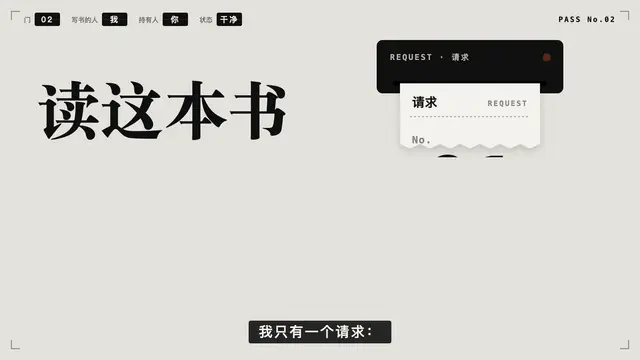
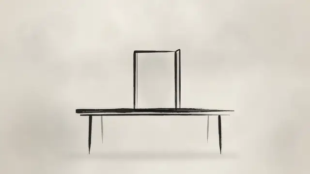
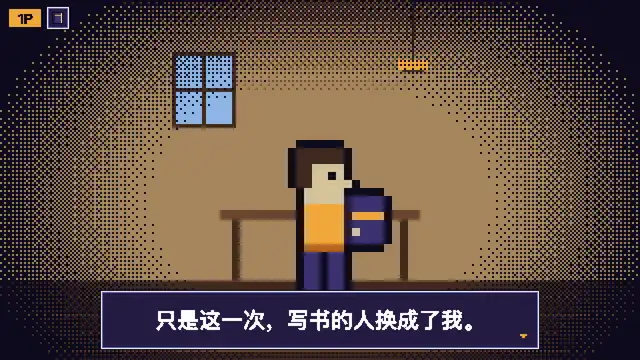
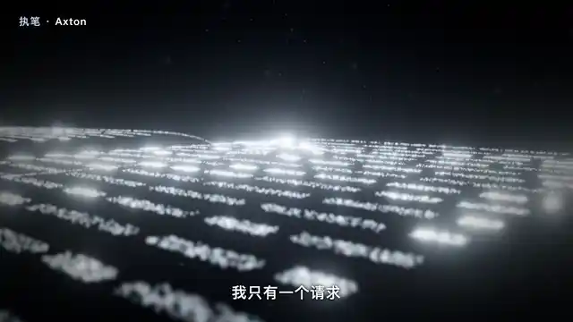
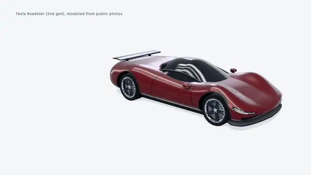
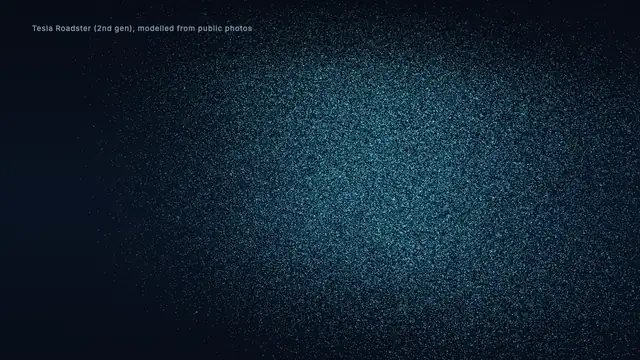
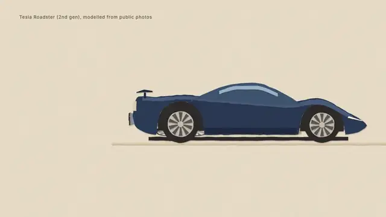

# Video Illustrator · 配视频

**你的声音，你的素材，任选一种画面。**

[English](README.md)

一个 Agent Skill：用你自己的旁白和你的真实素材（书封、课程封面、截图、logo，保持原样），按你选的风格做成 20–60 秒的宣传片或概念讲解片。交付 MP4 和可编辑的场景源码，在你自己的电脑上渲染。

## 同一段口播，6 种画面

每一格都是同一段 20.86 秒口播（作者本人的声音）和同一张真实书封。预览动图无声、循环播放；点开是带口播和配乐的完整版。

<table>
<tr>
<td width="33%" valign="top"><a href="https://youtu.be/9zBcFp49VeU"></a><br><b>编辑部科技风 <sup>v0.4</sup></b><br>大字排版、终端界面、票据；一张通行证从 01 翻到 02。<br><a href="https://youtu.be/9zBcFp49VeU">在 YouTube 观看</a> · <a href="https://www.bilibili.com/video/BV1RDa56jENM/?p=1">在 B 站观看</a></td>
<td width="33%" valign="top"><a href="https://youtu.be/eyvkcXT8J1g"></a><br><b>电影感 3D <sup>v0.4</sup></b><br>预告片的尺度：裂缝长成峡谷，十层楼高的门被推开。<br><a href="https://youtu.be/eyvkcXT8J1g">在 YouTube 观看</a> · <a href="https://www.bilibili.com/video/BV1RDa56jENM/?p=2">在 B 站观看</a></td>
<td width="33%" valign="top"><a href="https://youtu.be/RspPmhD8SuY"></a><br><b>剪纸拼贴 <sup>v0.5</sup></b><br>一道金线：纸沿书封裂缝撕开，裂缝变成公路、书签丝带和读者的笔迹。<br><a href="https://youtu.be/RspPmhD8SuY">在 YouTube 观看</a> · <a href="https://img.axtonliu.com/video-illustrator/samples/1-cut-paper-v05.mp4">直接播放</a></td>
</tr>
<tr>
<td width="33%" valign="top"><a href="https://youtu.be/o4fDdmcybLc"></a><br><b>水墨 <sup>v0.5</sup></b><br>一个矩形从门楼推进到书页版框；墨不出框，直到一笔朱砂冲出去。<br><a href="https://youtu.be/o4fDdmcybLc">在 YouTube 观看</a> · <a href="https://img.axtonliu.com/video-illustrator/samples/2-ink-wash-v05.mp4">直接播放</a></td>
<td width="33%" valign="top"><a href="https://youtu.be/onpxVv_pBMo"></a><br><b>像素复古 <sup>v0.5</sup></b><br>双人游戏：「作者：？？？」变成 Axton，HUD 把 2P 交给你。<br><a href="https://youtu.be/onpxVv_pBMo">在 YouTube 观看</a> · <a href="https://img.axtonliu.com/video-illustrator/samples/3-pixel-retro-v05.mp4">直接播放</a></td>
<td width="33%" valign="top"><a href="https://youtu.be/HjPDtsuzjF4"></a><br><b>粒子光轨 <sup>v0.5</sup></b><br>光点聚散成形；「执笔」从 —— 换成 Axton，再换成你。<br><a href="https://youtu.be/HjPDtsuzjF4">在 YouTube 观看</a> · <a href="https://img.axtonliu.com/video-illustrator/samples/4-particles-v05.mp4">直接播放</a></td>
</tr>
</table>

**积木（参照版）**：同一段口播的完整新书宣传片，由作者用内部产线制作，**不是**本 Skill 生成的。[在 YouTube 观看](https://youtu.be/iRScrftmJCU) · [在 B 站观看](https://www.bilibili.com/video/BV1fcax6JExX/)

每张预览图链接到 YouTube 上的完整版（带口播和配乐）；两条 v0.4 另附 B 站链接，四条 v0.5 另附可以直接播放的 MP4。本仓库不分发 MP4 文件本身。每一条都由一句话输入生成（Claude Code + Opus 5.5，effort high，作者本机环境），都是一次需求跑完、0 次修改：两条用 Skill 0.4，四条用 Skill 0.5。Skill 0.4 在出关键帧之前先定概念和一条贯穿全片的组织装置，每小节一个新画面，字幕按实测起音落拍，交付前自己看联系表（电影感那条的需求里附了一段导演说明）。Skill 0.5 加入了动效参数与克制预算、转场词汇和各媒介的手艺；交付前由干净上下文的独立审片按审美准则检查，决定陌生人会不会停下的三条（陌生人会不会停下、画面与尺度、离开桌面）可以有第二轮。0.5 的四条沿用各自上一版样片的配乐（Lyria 生成），没有新调用 Lyria。每条的原始指令、Skill 版本、耗时、API 标价口径成本和配乐来源见 [SAMPLES.md](showcase/SAMPLES.md)，那里也保留了这四种风格上一版的记录。另有一个轻量[风格页](showcase/index.html)，可以逐条播放样片，并一键复制对应风格的指令。

## 同一个机制，3 种画面

同一段 15 秒讲解插入镜头（无声，没有口播），用最适合讲机制的三种风格各渲染一遍：第二代 Tesla Roadster 的结构，从整车到四块轮胎接触面、吸地风扇、气罐和冷气推进器，再合回整车。一份内容文件，三次渲染；画面上每个数字都来自研究事实表并注明出处。详见 [SAMPLES.md](showcase/SAMPLES.md#9--roadster-structure-in-three-looks--roadster-结构三种画面-v09)；[三种画面上下叠放的对比片](https://img.axtonliu.com/video-illustrator/samples/9-roadster-compare-v09.mp4)。

<table>
<tr>
<td width="33%" valign="top"><br><b>图解立体 <sup>v0.9</sup></b><br>讲解默认风格：浅色纸面上的棚拍模型，只有一处暖色强调。<br><a href="https://img.axtonliu.com/video-illustrator/samples/9-roadster-diagram-3d-v09.mp4">直接播放</a></td>
<td width="33%" valign="top"><br><b>粒子光轨 <sup>v0.9</sup></b><br>同一套几何，画成深色底上的光点。<br><a href="https://img.axtonliu.com/video-illustrator/samples/9-roadster-particles-v09.mp4">直接播放</a></td>
<td width="33%" valign="top"><br><b>剪纸拼贴 <sup>v0.9</sup></b><br>2D 路线：侧面的纸车一层层拆开。<br><a href="https://img.axtonliu.com/video-illustrator/samples/9-roadster-cut-paper-v09.mp4">直接播放</a></td>
</tr>
</table>

## 怎么用

1. **把素材放进文件夹**（都可选）：

   ```text
   my-promo/
     inputs/voice/    你的旁白（录音或克隆音色导出）；可附 .srt 或 words.json 逐字时间
     inputs/assets/   书封、课程封面、截图、logo：保持原样，只缩放、位移、裁切、整体光效
     inputs/brand/    品牌包：brand.json（display_name、palette、fonts……）+ 可选字体、母题、片尾卡
   ```

2. **一句话说要什么**，点名一种风格：

   ```text
   用 video-illustrator 处理 ./my-promo：我的旁白在 inputs/voice，书封在 inputs/assets，品牌信息在 inputs/brand。做一支剪纸拼贴风格的宣传短片，1920×1080，带中文字幕，画面节奏跟着旁白走。不要编造素材里没有的内容。
   ```

3. **拿到成片和源码**：MP4、可编辑的 `scene.html`、记录创作选择的 `brief.md`（配乐、节拍、每个时间点发生什么）以及用到的素材，之后可以修改和重新渲染。

没有这些文件夹也照常工作，比如“用 20 秒白板动画讲清楚缓存为什么让重复请求更快”。单独出现的作者署名只用 [brand.json](references/brand.example.json) 里的 `display_name`，素材上原本印着的字不改。配色跟随所选风格，素材自带的颜色只作呼应；[品牌包](references/brand.md)设为整片配色时例外。`node scripts/brand.mjs --sheet inputs/brand --out brand-sheet.png` 生成一张品牌样张，先看样张认可品牌包，再做片子。想让每个项目都带上自己的审美，就在 `~/.config/video-illustrator/brand/` 放一个默认品牌包（或用 `$VIDEO_ILLUSTRATOR_BRAND` 指向它），它的 `rules_docs` 可以列出你自己的设计规则文档，每次做片前原地读取。

要电影感、预告片质感时走 3D 路线（three.js，在你的 GPU 上渲染：真实光照、景深、运动模糊，书封贴成立体书）；插画类风格仍走 2D。

**讲解模式**（0.7 新增）用于已经录好的口播。给它视频字幕和一个时间窗口，它切出这一段（`scripts/excerpt.mjs`），把旁白讲的机制做成几个常驻的部件和在它们之间传递的东西，每个变化落在说到它的那句话上，交付无声的横版和竖版插入镜头供你自己剪辑，另附带旁白和字幕的预览。见 [explainer.md](references/explainer.md)。

从 0.9 起，所有模式都从同一份风格图谱选画风：讲解插入和整期片默认用明亮的 3D 图解（`diagram-3d`），也可以换成图谱里能承载机制的其他风格，走 3D 路线，或走读同一份内容的 2D 起点（例如粒子光轨、剪纸拼贴）。哪些风格适合、其余为什么不适合，见 [styles.md](references/styles.md#carrying-an-explainer--讲解承载)。

## 安装

为 **Claude Code + Opus 5.5** 设计，其他宿主未验证。

需要：

- Node.js 20 或更新
- PATH 中的 FFmpeg 和 ffprobe
- Playwright Chromium（下面的命令会安装）
- 可选，生成配乐：环境变量里放你自己的 `OPENROUTER_API_KEY`。配乐来自 OpenRouter 上的 Google Lyria 3，付费调用，约 0.04 美元/30 秒，只在你授权时调用。音效在本地程序合成，不收费。也可以让 Skill 从你已有的曲库里选。生成配乐时可以把关键帧或素材图作为参考图一起传给模型（最多 10 张），让音乐贴合画面；也可以改用 Gemini API（`GEMINI_API_KEY`）。

保持 `video-illustrator` 文件夹完整，放到 Skill 目录（Claude Code 项目级目录为 `.claude/skills/video-illustrator/`，或用 symlink 指向你的源码位置），然后在 Skill 文件夹运行：

```sh
npm ci
npx playwright install chromium
```

`npm ci` 同时安装 3D 路线用到的 three.js（MIT，版本已锁定）。渲染全部在本地进行，不上传到任何渲染服务。coding agent 自身仍需模型访问权限。

**GPU 渲染**（3D 路线）：在 macOS + Apple M4 Pro 上实测，`--gpu` 走 ANGLE Metal，起始场景 1080p 加胶片颗粒约 0.3 秒/帧。没有 GPU 时 Chromium 退回软件渲染，能用，但实测慢 2–15 倍（取决于运动模糊）。Windows、Linux 和其他 GPU 未测试。

## 当前边界

早期预览版，随缘维护。这是代码驱动的动画，不是写实视频模型，也不做自动事实核查；一句话不保证每次都直接成片。长叙事、字体和音频可能需要额外处理。发布前请看完成片并核对内容。欢迎可复现的问题和聚焦的 PR。

## 更多

- [风格目录](references/styles.md)：全部风格方向与选择方法，大多数还没有样片。
- [SAMPLES.md](showcase/SAMPLES.md)：每条样片是怎么做出来的。
- [VALIDATION.md](VALIDATION.md)：实际测过什么。
- [致谢与第三方许可](references/credits.md)。
- [渲染说明](references/rendering.md)：渲染接口、草稿、先音乐后画面的流程。
- [讲解模式](references/explainer.md)：把已有口播视频中的一段做成机制示意插入镜头。

## 许可与作者

代码与文档：[MIT](LICENSE)，© 2026 Axton Liu。showcase 中的样片、预览动图和封面帧包含作者本人的声音、书封和授权配乐，仅用于展示本 Skill，不在 MIT 许可范围内（见 [SAMPLES.md](showcase/SAMPLES.md#material-and-rights--素材与授权)）。你自行加入的第三方素材遵守各自许可。

作者：[Axton Liu](https://www.axtonliu.com/) · [X](https://x.com/AxtonLiu)
